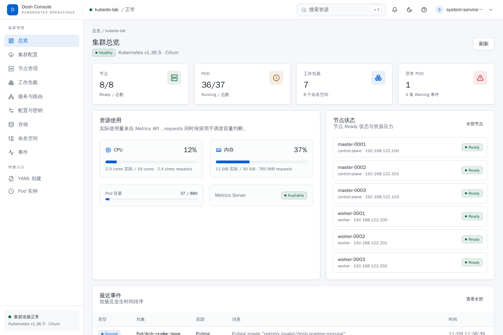
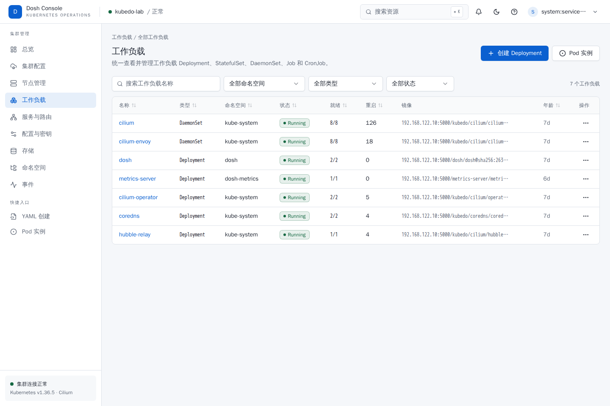
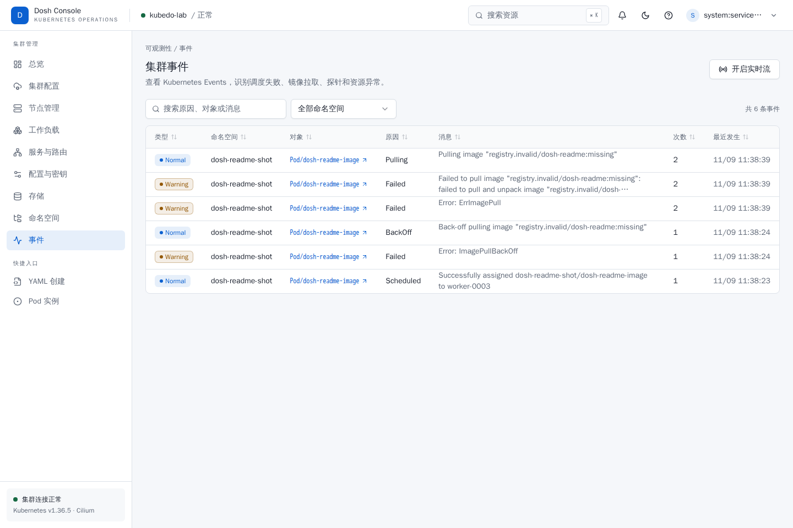
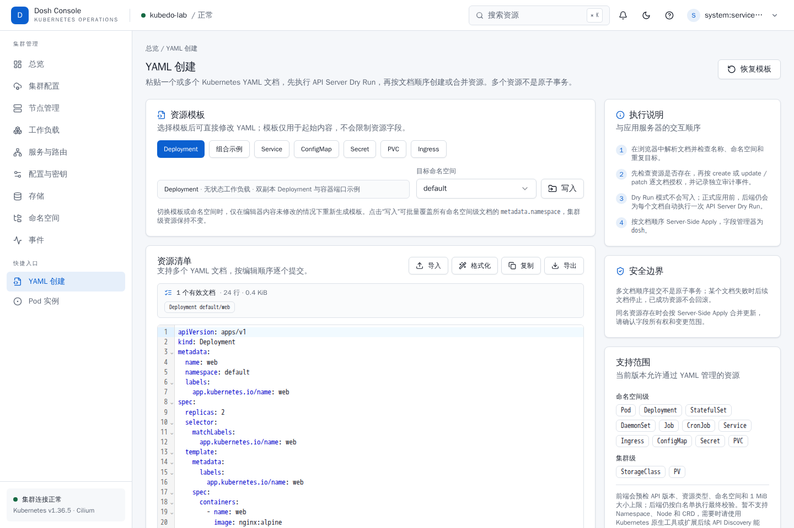

<div align="center">
  

  <h1>Dosh</h1>

  <p><strong>A lightweight Kubernetes operations console for everyday cluster work</strong></p>

  <p>One binary for cluster overview, curated operations views, generic resource discovery, Pod logs, networking, configuration, storage, events, YAML creation, and audit trails.</p>

  <p><a href="#quick-start">Quick start</a> · <a href="#screenshots">Screenshots</a> · <a href="#features">Features</a> · <a href="#deployment-and-configuration">Deployment</a> · <a href="#authentication-and-permissions">Authentication</a> · <a href="#local-development">Development</a> · <a href="docs/operations-runbook.md">Runbook</a></p>

  <p><sub><strong>English</strong> · <a href="README.zh-CN.md">简体中文</a></sub></p>
</div>

## What is Dosh?

Dosh is a self-hosted Kubernetes operations console for platform teams, SREs, and day-to-day operators. Its information architecture is inspired by Huawei Cloud CCE, but its visual system and interaction model are purpose-built for fast, focused cluster work instead of jumping between `kubectl`, multiple log windows, and a YAML editor.

Dosh does not replace Kubernetes or bypass it. Authentication, authorization, and every resource operation are ultimately enforced by the Kubernetes API Server, TokenReview, SubjectAccessReview, and RBAC.

### Highlights

- **Lightweight deployment** — the frontend is embedded into the Go binary with `go:embed`; there is no external database and no in-cluster agent. The runtime image is distroless and runs as a non-root user.
- **Kubernetes-native permissions** — Bearer Token login is the default, with optional OIDC and local-admin modes. Dosh does not create a separate user system or silently elevate privileges.
- **Complete operational workflows** — nodes, workloads, Pods, logs, Services, Ingresses, ConfigMaps, Secrets, PVCs, namespaces, events, and audit history in one place.
- **Guarded by default** — write operations pass through RBAC, CSRF protection, resource-version checks, and auditing. Global read-only mode, dangerous-action confirmation, and YAML dry runs are built in.
- **HTTP and HTTPS** — the same binary supports both modes. TLS certificates can be mounted read-only from a Secret and reloaded without restarting Pods.
- **Mobile ready** — tables, search, dialogs, and detail views are responsive enough for checking cluster health and handling alerts from a phone.

## Screenshots

<p align="center">
  
</p>

| Workloads | Cluster events |
|---|---|
|  |  |



> Screenshots are captured from a live console. The current UI is Chinese-first while the product documentation is available in English and Simplified Chinese.

## Features

| Area | Capabilities |
|---|---|
| Cluster overview | Kubernetes version, CNI, node and Pod health, workload counts, CPU/memory usage, and scheduling capacity; automatically falls back to requests data when the Metrics API is unavailable |
| Nodes | Status, roles, capacity, labels, taints, Pod placement, events, and logs; cordon/uncordon according to permissions |
| Workloads | Deployments, StatefulSets, DaemonSets, Jobs, and CronJobs; details, Pods, container configuration, related Services, events, logs, and YAML |
| Workload actions | Create Deployments, scale, rolling restart, update images, suspend/resume CronJobs, delete resources, inspect Deployment/StatefulSet revision history, roll back revisions, and edit YAML within resource-level permissions |
| Pods | Status, containers, restart counts, resources, node, events, logs, and YAML; stream live logs from a selected container |
| Networking | Service and Ingress lists and details; create, edit, and delete ClusterIP, NodePort, LoadBalancer, and Ingress resources according to permissions |
| Configuration | View, create, edit, delete, inspect data, and edit YAML for ConfigMaps and Secrets; Secret data is returned only to authorized, audited requests |
| Storage | Create and manage PVCs; inspect PVs and StorageClasses and navigate their relationships |
| Namespaces | Create, inspect, view YAML, and perform protected cascade deletion; `default` and `kube-*` are always protected from deletion |
| Events | Cluster-wide search, namespace filtering, warning detection, object deep links, and a live event stream |
| Resource explorer | Kubernetes API Discovery catalog for built-in resources and CRD types; filter by API group, kind, and resource name; generic list, detail, events, YAML create/edit/delete, and namespace filtering, with all reads and writes enforced by Kubernetes RBAC; generic Secret writes remain in the dedicated editor |
| YAML creation | Template editing, dry run, create, or server-side apply; multi-document sequential submission with a built-in resource allowlist; CRDs and other discovered resources use the resource explorer's YAML editor |
| Cluster configuration | Kubernetes version, platform, CNI, control-plane endpoint, DNS domain, Pod/Service CIDRs, and per-node Pod CIDRs |
| Audit | Authentication and write-operation history; events are written to stdout with optional HTTPS webhook delivery and HMAC signing |
| Server certificate | Certificate validity, SANs, key algorithm, fingerprint, and reload status; automatic hot reload after certificate rotation |

## Design principles

### Permissions follow Kubernetes

Dosh does not store user Kubernetes credentials or maintain a parallel role system. Token authentication works as follows:

1. The server validates the token identity with `TokenReview`.
2. The server issues an encrypted HttpOnly session cookie; the token never enters the cookie, browser storage, or audit logs.
3. API requests use impersonation to call the Kubernetes API Server as the current user.
4. UI controls and API operations evaluate permissions with `SubjectAccessReview`.

As a result, the resources a user can see and the actions they can perform in Dosh match what they could do directly with `kubectl`.

### Write operations are deliberately conservative

- Delete, restart, suspend, and cascade operations require explicit confirmation; deleting workloads and namespaces requires typing the resource name.
- Updates carry `resourceVersion` to avoid overwriting concurrent changes from another operator.
- YAML creation performs a dry run first, then checks `create` or `update`/`patch` permission based on whether the target already exists.
- Every write, authentication event, and sensitive data read produces an audit record.
- Setting `runtime.readOnly=true` turns the entire console read-only.

### One binary, minimal dependencies

```text
Browser
  └─ HTTP / HTTPS :32626
       └─ Go BFF + embedded React SPA
            ├─ authentication, RBAC, CSRF, audit
            ├─ client-go → Kubernetes API Server
            ├─ SSE event stream / Pod log stream
            └─ metrics.k8s.io (optional)
```

The backend follows an `http → app → domain` dependency direction, and `platform/kube` implements only the minimal ports defined by the layers above it. Routing, use cases, and Kubernetes adapters remain separate; [`api/openapi.yaml`](api/openapi.yaml) is the single source of truth for the REST contract.

## Quick start

### Prerequisites

- Kubernetes `1.30+`
- Helm `3.x`
- Credentials with access to the Kubernetes API
- A reachable image registry for Dosh, or a locally built image

### 1. Create a namespace and session key

```bash
kubectl create namespace dosh

kubectl -n dosh create secret generic dosh-auth \
  --from-literal=session-key="$(openssl rand -base64 48)"
```

### 2. Prepare an HTTPS certificate (recommended for production)

The certificate SAN must include the address users will visit. Create a standard TLS Secret:

```bash
kubectl -n dosh create secret tls dosh-tls \
  --cert=/path/to/tls.crt \
  --key=/path/to/tls.key
```

For an isolated evaluation you may skip the TLS Secret and disable TLS during installation.

> Do not transmit tokens or Secret data over plain HTTP in production.

### 3. Install Dosh

The default chart pulls from GHCR, exposes NodePort `32626`, runs two replicas, and uses cross-node anti-affinity:

```bash
helm upgrade --install dosh oci://ghcr.io/kube-dosh/charts/dosh \
  --namespace dosh \
  --create-namespace \
  --version 0.1.10 \
  --set runtime.clusterName=my-cluster
```

For an HTTP evaluation deployment, use the full command:

```bash
helm upgrade --install dosh oci://ghcr.io/kube-dosh/charts/dosh \
  --namespace dosh \
  --create-namespace \
  --version 0.1.10 \
  --set runtime.clusterName=my-cluster \
  --set tls.enabled=false \
  --set auth.cookieSecure=false
```

Check the rollout:

```bash
helm -n dosh status dosh
kubectl -n dosh rollout status deployment/dosh
```

Visit `https://<node-ip>:32626` for HTTPS or `http://<node-ip>:32626` for the HTTP evaluation deployment. The first visit opens the login page.

### 4. Sign in

The default authentication mode is Kubernetes Token. Create a short-lived token for a ServiceAccount with the permissions you need:

```bash
kubectl -n <namespace> create token <service-account> --duration=1h
```

Paste the output into the login page. The token's permissions are determined by the identity's RBAC; Dosh never grants cluster permissions on its own.

For an isolated evaluation only, you can create a temporary administrator:

```bash
kubectl -n dosh create serviceaccount dosh-admin
kubectl create clusterrolebinding dosh-admin \
  --clusterrole=cluster-admin \
  --serviceaccount=dosh:dosh-admin
kubectl -n dosh create token dosh-admin --duration=1h
```

Production deployments should use a least-privilege ServiceAccount or an OIDC identity instead of distributing long-lived `cluster-admin` tokens.

## Build the image

```bash
make web-install
make build

make image TAG=0.1.8
make push  TAG=0.1.8
```

The default image is `ghcr.io/kube-dosh/dosh:0.1.8`. Override `IMAGE` to push to another registry:

```bash
IMAGE=registry.example.com/dosh/dosh make image TAG=0.1.8
```

`make build` builds the frontend into `web/dist`, then embeds the static assets into `bin/dosh`. The runtime image contains only that binary.

## Deployment and configuration

The main Helm settings live in [`deploy/helm/dosh/values.yaml`](deploy/helm/dosh/values.yaml):

| Setting | Default | Description |
|---|---|---|
| `replicaCount` | `2` | Number of Dosh replicas |
| `image.repository` / `image.tag` | `ghcr.io/kube-dosh/dosh` / `0.1.8` | Public image; pin a digest in production |
| `service.type` / `service.port` | `NodePort` / `32626` | Service type and container port |
| `service.nodePort` | `32626` | NodePort exposure |
| `tls.enabled` | `true` | Enable HTTPS |
| `tls.existingSecret` | `dosh-tls` | Secret containing `tls.crt` and `tls.key` |
| `auth.mode` | `token` | `token`, `oidc`, or `local` |
| `rbac.localReadAllResources` | `true` | In local mode, grant cluster-wide read access so the resource explorer can browse built-in resources and CRDs; Token/OIDC modes continue to use the user's Kubernetes RBAC |
| `auth.existingSecret` | `dosh-auth` | Session key and other sensitive authentication settings |
| `auth.sessionTTL` | `8h` | Login session lifetime, capped at 8 hours |
| `runtime.clusterName` | `kubedo-lab` | Cluster name displayed by the console |
| `runtime.readOnly` | `false` | Disable all write operations |
| `audit.webhook.enabled` | `false` | Deliver audit events to an HTTPS receiver |
| `networkPolicy.enabled` | `true` | Create the default network policies |

After a TLS certificate rotation, Dosh checks the mounted files every 30 seconds by default and reloads them without restarting Pods. See the [`operations runbook`](docs/operations-runbook.md) for certificate, audit, network-policy, and rollback details.

## Authentication and permissions

| Mode | Best for | How it works |
|---|---|---|
| `token` | Default mode, ServiceAccounts, automation | Validates identity with `TokenReview` and accesses the cluster as that user |
| `oidc` | Enterprise single sign-on | Authorization Code + PKCE with issuer, audience, state, and nonce validation |
| `local` | Isolated environments without an IdP | Local administrator username and password hash; cluster access still follows configured permissions |

Set the mode with `auth.mode`. OIDC organization mapping, CA configuration, administrator groups, and rollback procedures are covered in the operations runbook.

## Compatibility and boundaries

- **Kubernetes** — the chart requires Kubernetes `1.30+`.
- **Metrics** — without Metrics Server, CPU and memory views fall back to Pod requests and node allocatable values; resource management remains available.
- **YAML creation** — `/yaml/create` uses a controlled allowlist for common built-in resources and does not expose Namespaces or Nodes. CRDs and other discovered resources use the resource explorer's generic YAML editor; generic Secret writes are disabled in favor of the dedicated editor.
- **Storage** — PVCs support permission-protected create, edit, and delete operations; PV and StorageClass support is focused on inspection and relationship navigation.
- **Secrets** — users with read permission can view Secret data. This is RBAC-controlled and audited; there is no additional masking layer in Dosh.
- **Browsers** — a recent Chrome, Edge, Firefox, or Safari is recommended for the responsive interface.

## Local development

Requirements: Go `1.26+`, Node.js `24+`, npm, and a kubeconfig with access to a Kubernetes cluster.

```bash
make web-install

export DOSH_SESSION_KEY="$(openssl rand -base64 48)"
export DOSH_AUTH_MODE=token
export DOSH_CLUSTER_NAME=dev-cluster
export DOSH_READ_ONLY=false

make web-build
go run ./cmd/dosh
```

For frontend development:

```bash
cd web
npm run dev
```

Open `http://127.0.0.1:5173`. Vite proxies `/api`, `/healthz`, and `/readyz` to `http://127.0.0.1:32626`.

Common quality checks:

```bash
make verify
make web-e2e-container
```

See the operations runbook for the full test matrix, Playwright isolation requirements, and release gates.

## Project structure

```text
cmd/dosh/                entry point
internal/bootstrap/      dependency wiring, router, and lifecycle
internal/modules/        feature modules split into http / app / domain
internal/platform/       Kubernetes, configuration, audit, and infrastructure adapters
web/                     React + TypeScript + Tailwind + shadcn-style components
api/openapi.yaml         REST API contract
deploy/helm/dosh/        Helm chart
docs/                    requirements, design, roadmap, and operations runbook
scripts/                 build, verification, and release helpers
```

## Documentation

- [Operations runbook](docs/operations-runbook.md) — deployment, certificates, tokens, auditing, rollback, and troubleshooting
- [EARS implementation plan](docs/ears-implementation-plan.md) — requirements, acceptance criteria, and implementation steps
- [Cluster management roadmap](docs/cluster-management-roadmap.md) — planned capabilities
- [Commercialization checklist](docs/commercialization-todo.md) — external dependencies and production gates
- [GitHub release pipeline](docs/github-release.md) — tag releases, multi-architecture artifacts, GHCR images, and Helm OCI charts
- [OpenAPI contract](api/openapi.yaml) — REST API definition

The detailed operational documents are currently maintained in Chinese. The English README is the default project entry point, and documentation will continue to be expanded in both languages.

---

If you need a lightweight console that stays close to Kubernetes permissions and works well for internal operations on desktop and mobile, Dosh is built for that job.

## License

Apache License 2.0. See [LICENSE](LICENSE).
