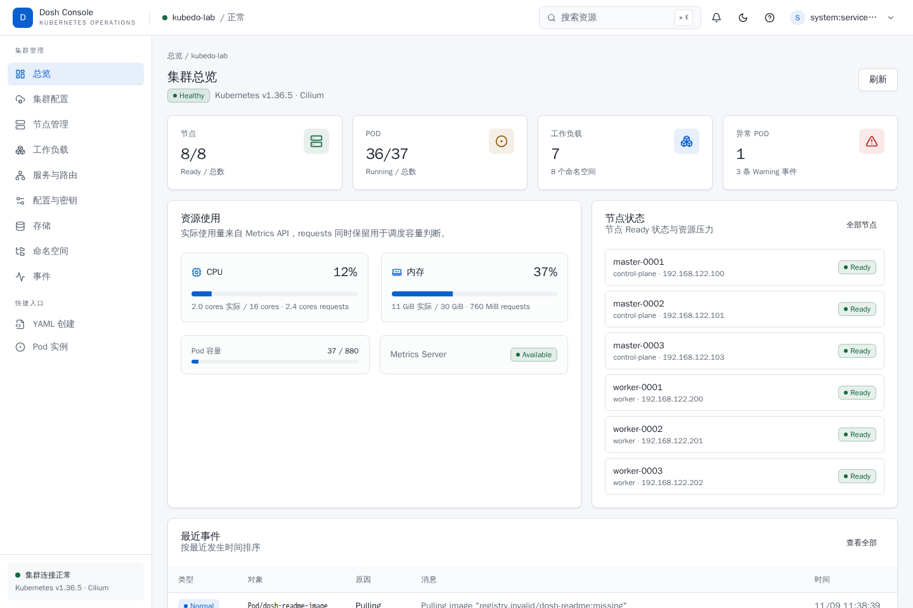
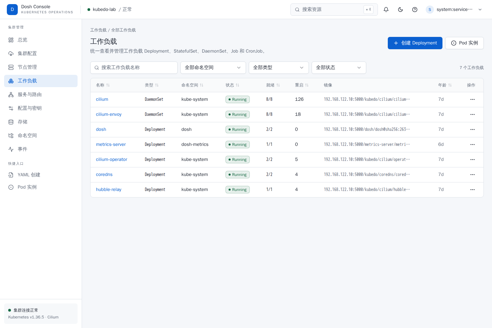
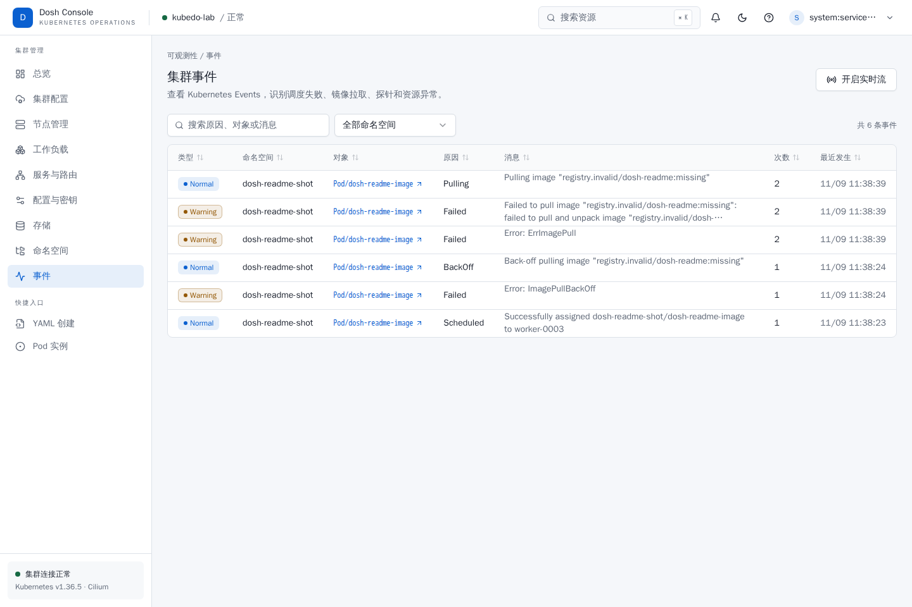
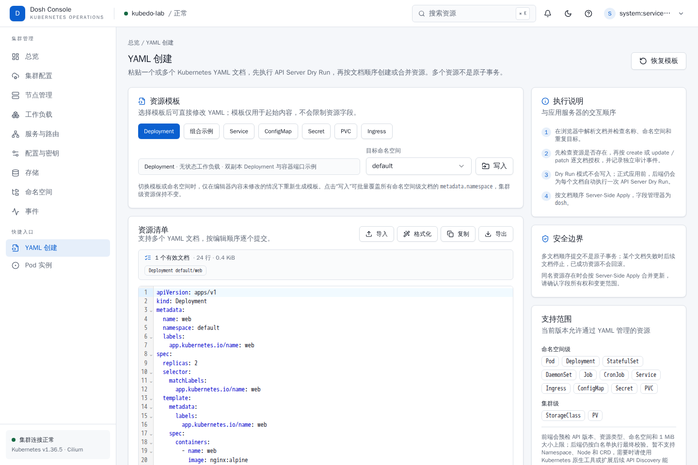

<div align="center">
  

  <h1>Dosh</h1>

  <p><strong>面向 Kubernetes 日常运维的轻量级可视化控制台</strong></p>

  <p>一个二进制，提供集群总览、固定运维视图、通用资源浏览器、Pod 日志、网络、配置、存储、事件、YAML 创建与审计能力。</p>

  <p><a href="#快速开始">快速开始</a> · <a href="#产品截图">产品截图</a> · <a href="#功能一览">功能一览</a> · <a href="#部署与配置">部署与配置</a> · <a href="#认证与权限">认证与权限</a> · <a href="#本地开发">本地开发</a> · <a href="docs/operations-runbook.md">运维手册</a></p>

  <p><sub><a href="README.md">English</a> · <strong>简体中文</strong></sub></p>
</div>

## Dosh 是什么

Dosh 是一套自研的 Kubernetes 运维控制台，面向平台团队、SRE 和日常运维人员。它以华为云 CCE 的信息层级和操作习惯为参考，重新设计了视觉与交互，让常见运维任务在一个界面中完成，而不是在多个 `kubectl` 命令、日志窗口和 YAML 编辑器之间来回切换。

Dosh 不替代 Kubernetes，也不绕过 Kubernetes。所有身份、权限和资源操作最终都由 API Server、TokenReview、SubjectAccessReview 和 RBAC 决定。

### 核心特点

- **轻量部署**：前端通过 `go:embed` 打包进 Go 二进制，不依赖外部数据库或集群内 Agent；运行时使用 distroless 非 root 镜像。
- **Kubernetes 原生权限**：默认使用 Bearer Token 登录，也支持 OIDC 和本地管理员模式；默认不另建用户体系，不替用户提升权限。
- **日常运维闭环**：覆盖节点、工作负载、Pod、日志、Service、Ingress、ConfigMap、Secret、PVC、命名空间、事件和审计。
- **安全可控**：写操作经过 RBAC、CSRF、资源版本锁和审计；支持全局只读模式、危险操作确认和 YAML Dry Run。
- **HTTP/HTTPS 一体**：同一个二进制支持两种传输模式；HTTPS 证书可从 Secret 只读挂载并热加载。
- **移动端可用**：列表、搜索、弹窗和详情页均针对窄屏做了适配，可直接在手机上查看集群状态和处理告警。

## 产品截图

<p align="center">
  
</p>

| 工作负载 | 集群事件 |
|---|---|
|  |  |



> 截图来自真实控制台，展示当前的中文界面。

## 功能一览

| 模块 | 主要能力 |
|---|---|
| 集群总览 | 集群版本、CNI、节点与 Pod 健康度、工作负载数量、CPU/内存使用和调度容量；Metrics API 不可用时自动回退到 requests 数据 |
| 节点管理 | 节点状态、角色、容量、标签、污点、Pod 分布、事件和日志；按权限执行停止/恢复调度 |
| 工作负载 | Deployment、StatefulSet、DaemonSet、Job、CronJob；详情、实例、容器配置、关联 Service、事件、日志和 YAML |
| 工作负载操作 | 创建 Deployment、扩缩容、滚动重启、更新镜像、暂停/恢复 CronJob、删除、查看 Deployment/StatefulSet 发布历史并回滚，以及按资源级权限编辑 YAML |
| Pod | 状态、容器、重启次数、资源、节点、事件、日志和 YAML；支持选择容器查看实时日志 |
| 网络 | Service 与 Ingress 列表和详情；按权限创建、编辑、删除 ClusterIP、NodePort、LoadBalancer 和 Ingress |
| 配置与密钥 | ConfigMap、Secret 的查看、创建、编辑、删除、数据查看和 YAML；Secret 数据仅对有权限且经过审计的请求返回 |
| 存储 | PVC 创建与管理；PV、StorageClass 查看与关联关系导航 |
| 命名空间 | 创建、详情、YAML 和受保护的级联删除；`default` 与 `kube-*` 始终拒绝删除 |
| 事件 | 集群事件检索、命名空间过滤、Warning 识别、对象快速跳转和实时事件流 |
| 资源浏览器 | 通过 Kubernetes API Discovery 浏览内置资源与 CRD 类型；按 API Group、Kind、资源名筛选；提供通用列表、详情、事件、YAML 创建/编辑/删除和命名空间过滤，所有读写均受 Kubernetes RBAC 约束；通用 Secret 写入仍由专用页面承担 |
| YAML 创建 | 按模板编辑、Dry Run、创建或 Server-Side Apply；支持多文档顺序提交和常用内置资源白名单；CRD 与其他已发现资源通过资源浏览器进入 YAML 写入 |
| 集群配置 | Kubernetes 版本、平台、CNI、控制面地址、DNS 域名、Pod/Service 网段和节点 Pod CIDR |
| 审计 | 查看认证与写操作审计记录；审计同时写入标准输出，可选 HTTPS Webhook 和 HMAC 签名 |
| 服务端证书 | 查看 HTTPS 证书有效期、SAN、密钥算法、指纹和加载状态；证书更新后按周期热加载 |

## 设计原则

### 权限跟随 Kubernetes

Dosh 不保存用户的 Kubernetes 凭据，也不使用独立的角色系统。Token 登录流程如下：

1. 服务端使用 `TokenReview` 校验 Token 身份。
2. 服务端创建加密 HttpOnly 会话 Cookie，Token 不进入 Cookie、浏览器存储或审计日志。
3. 业务请求通过 impersonation 使用当前用户身份访问 API Server。
4. 页面按钮和 API 操作分别通过 `SubjectAccessReview` 判断权限。

因此，用户在 Dosh 中能看到的资源和能执行的操作，与直接使用 `kubectl` 时保持一致。

### 写操作默认谨慎

- 删除、重启、暂停和级联操作需要明确确认；删除工作负载和命名空间需要输入资源名称。
- 更新资源时携带 `resourceVersion`，避免覆盖其他操作者的并发修改。
- YAML 创建先执行 Dry Run，再根据目标资源是否存在检查 `create` 或 `update`/`patch` 权限。
- 所有写操作、认证事件和敏感数据读取都会生成审计记录。
- 可通过 `runtime.readOnly=true` 将整个控制台切换为只读。

### 单二进制、低依赖

```text
浏览器
  └─ HTTP / HTTPS :32626
       └─ Go BFF + 内嵌 React SPA
            ├─ 认证、RBAC、CSRF、审计
            ├─ client-go → Kubernetes API Server
            ├─ SSE 事件流 / Pod 日志流
            └─ metrics.k8s.io（可选）
```

后端采用 `http → app → domain` 的依赖方向，`platform/kube` 只实现上层定义的最小端口。路由、业务用例和 Kubernetes 适配层保持分离，API 契约以 [`api/openapi.yaml`](api/openapi.yaml) 为唯一来源。

## 快速开始

### 前置条件

- Kubernetes `1.30+`
- Helm `3.x`
- 可访问 Kubernetes API 的集群凭据
- 一个可用的 Dosh 镜像仓库；或从源码构建镜像

### 1. 创建命名空间和会话密钥

```bash
kubectl create namespace dosh

kubectl -n dosh create secret generic dosh-auth \
  --from-literal=session-key="$(openssl rand -base64 48)"
```

### 2. 准备 HTTPS 证书（生产推荐）

证书的 SAN 必须包含实际访问地址。创建标准 TLS Secret：

```bash
kubectl -n dosh create secret tls dosh-tls \
  --cert=/path/to/tls.crt \
  --key=/path/to/tls.key
```

如只做隔离环境体验，也可以略过 TLS Secret，并在部署时关闭 TLS。

> 不要在生产环境通过明文 HTTP 传输 Token 或 Secret 数据。

### 3. 安装 Dosh

默认 Chart 从 GHCR 拉取镜像，使用 NodePort `32626`、2 副本和跨节点反亲和：

```bash
helm upgrade --install dosh oci://ghcr.io/kube-dosh/charts/dosh \
  --namespace dosh \
  --create-namespace \
  --version 0.1.10 \
  --set runtime.clusterName=my-cluster
```

HTTP 试用部署可以使用完整命令：

```bash
helm upgrade --install dosh oci://ghcr.io/kube-dosh/charts/dosh \
  --namespace dosh \
  --create-namespace \
  --version 0.1.10 \
  --set runtime.clusterName=my-cluster \
  --set tls.enabled=false \
  --set auth.cookieSecure=false
```

检查发布状态：

```bash
helm -n dosh status dosh
kubectl -n dosh rollout status deployment/dosh
```

HTTPS 部署访问 `https://<node-ip>:32626`；HTTP 试用部署访问 `http://<node-ip>:32626`。首次打开会进入登录页。

### 4. 登录

默认认证模式为 Kubernetes Token。准备一个具备目标集群权限的 ServiceAccount，并签发短期 Token：

```bash
kubectl -n <namespace> create token <service-account> --duration=1h
```

将输出粘贴到登录页即可。Token 的权限取决于对应身份的 RBAC；Dosh 不会自动授予集群权限。

仅用于隔离体验时，可以创建一个临时管理员：

```bash
kubectl -n dosh create serviceaccount dosh-admin
kubectl create clusterrolebinding dosh-admin \
  --clusterrole=cluster-admin \
  --serviceaccount=dosh:dosh-admin
kubectl -n dosh create token dosh-admin --duration=1h
```

生产环境应使用最小权限 ServiceAccount 或 OIDC 身份，不要长期分发 `cluster-admin` Token。

## 构建镜像

```bash
make web-install
make build

make image TAG=0.1.8
make push  TAG=0.1.8
```

默认镜像名为 `ghcr.io/kube-dosh/dosh:0.1.8`。需要推送到其他仓库时，通过 `IMAGE` 覆盖：

```bash
IMAGE=registry.example.com/dosh/dosh make image TAG=0.1.8
```

`make build` 会先构建前端并生成 `web/dist`，随后将静态资源嵌入 `bin/dosh`。运行镜像只包含该二进制。

## 部署与配置

主要 Helm 配置位于 [`deploy/helm/dosh/values.yaml`](deploy/helm/dosh/values.yaml)：

| 配置项 | 默认值 | 说明 |
|---|---|---|
| `replicaCount` | `2` | Dosh 副本数 |
| `image.repository` / `image.tag` | `ghcr.io/kube-dosh/dosh` / `0.1.8` | 公共镜像；生产建议固定 digest |
| `service.type` / `service.port` | `NodePort` / `32626` | 对外服务类型和容器端口 |
| `service.nodePort` | `32626` | NodePort 端口 |
| `tls.enabled` | `true` | 是否启用 HTTPS |
| `tls.existingSecret` | `dosh-tls` | 存放 `tls.crt` 与 `tls.key` 的 Secret |
| `auth.mode` | `token` | `token`、`oidc` 或 `local` |
| `rbac.localReadAllResources` | `true` | local 模式下授予全资源只读权限，支持资源浏览器浏览内置资源和 CRD；不影响 Token/OIDC 的用户级 RBAC |
| `auth.existingSecret` | `dosh-auth` | 会话密钥等敏感配置 |
| `auth.sessionTTL` | `8h` | 登录会话有效期，最大 8 小时 |
| `runtime.clusterName` | `kubedo-lab` | 控制台展示的集群名称 |
| `runtime.readOnly` | `false` | 是否禁用全部写操作 |
| `audit.webhook.enabled` | `false` | 是否向 HTTPS 审计接收端投递事件 |
| `networkPolicy.enabled` | `true` | 是否创建默认网络策略 |

TLS 证书更新后，Dosh 默认每 30 秒检查一次挂载文件并热加载，不需要重启 Pod。详细证书、审计、网络策略和回滚流程见 [`docs/operations-runbook.md`](docs/operations-runbook.md)。

## 认证与权限

| 模式 | 适用场景 | 说明 |
|---|---|---|
| `token` | 默认模式、ServiceAccount、自动化运维 | 通过 `TokenReview` 校验，按用户身份访问集群 |
| `oidc` | 企业统一身份 | Authorization Code + PKCE，校验 issuer、audience、state 和 nonce |
| `local` | 无 IdP 的隔离环境 | 本地管理员用户名和密码哈希，仍按配置权限操作集群 |

认证模式通过 `auth.mode` 配置。OIDC 的组织映射、CA、管理员组和回滚方式见运维手册。

## 兼容性与边界

- **Kubernetes**：Chart 要求 Kubernetes `1.30+`。
- **Metrics**：未安装 Metrics Server 时，CPU/内存展示 Pod requests 和节点 allocatable，不影响资源管理。
- **YAML 创建**：`/yaml/create` 使用受控的内置资源白名单，暂不开放 Namespace 和 Node；CRD 与其他已发现资源通过资源浏览器的通用 YAML 编辑器创建、更新和删除，Secret 通用写入关闭并继续使用专用页面。
- **存储**：PVC 支持受权限保护的创建、编辑和删除；PV、StorageClass 以查看和关联导航为主。
- **Secret**：拥有读取权限的用户可以查看 Secret 数据；该行为受 RBAC 约束并写入审计，不提供额外的二次遮蔽层。
- **浏览器**：遵循同一套响应式界面，建议使用较新的 Chrome、Edge、Firefox 或 Safari。

## 本地开发

前置条件：Go `1.26+`、Node.js `24+`、npm，以及可访问 Kubernetes 的 kubeconfig。

```bash
make web-install

export DOSH_SESSION_KEY="$(openssl rand -base64 48)"
export DOSH_AUTH_MODE=token
export DOSH_CLUSTER_NAME=dev-cluster
export DOSH_READ_ONLY=false

make web-build
go run ./cmd/dosh
```

前端开发服务器：

```bash
cd web
npm run dev
```

访问 `http://127.0.0.1:5173`。Vite 会将 `/api`、`/healthz` 和 `/readyz` 代理到 `http://127.0.0.1:32626`。

常用质量检查：

```bash
make verify
make web-e2e-container
```

完整的测试矩阵、Playwright 隔离约束和发布门禁见运维手册。

## 项目结构

```text
cmd/dosh/                程序入口
internal/bootstrap/      依赖装配、Router 和生命周期
internal/modules/        按业务模块拆分的 http / app / domain
internal/platform/       Kubernetes、配置、审计等基础设施适配
web/                     React + TypeScript + Tailwind + shadcn 风格组件
api/openapi.yaml         API 契约
deploy/helm/dosh/        Helm Chart
docs/                    需求、方案、路线图和运维手册
scripts/                 构建、验证和发布辅助脚本
```

## 文档

- [运维手册](docs/operations-runbook.md)：部署、证书、Token、审计、回滚和故障排查
- [EARS 实施计划](docs/ears-implementation-plan.md)：需求、验收标准和实施步骤
- [集群管理路线图](docs/cluster-management-roadmap.md)：后续能力规划
- [商用化 TODO](docs/commercialization-todo.md)：外部依赖和商业化门禁
- [GitHub 发布流水线](docs/github-release.md)：标签发布、双架构产物、GHCR 镜像和 Helm OCI Chart
- [OpenAPI 契约](api/openapi.yaml)：REST API 定义

---

如果你正在寻找一个轻量、贴近 Kubernetes 权限模型、适合内网和移动端日常运维的控制台，Dosh 就是为此而构建的。

## License

Apache License 2.0，详见 [LICENSE](LICENSE)。
